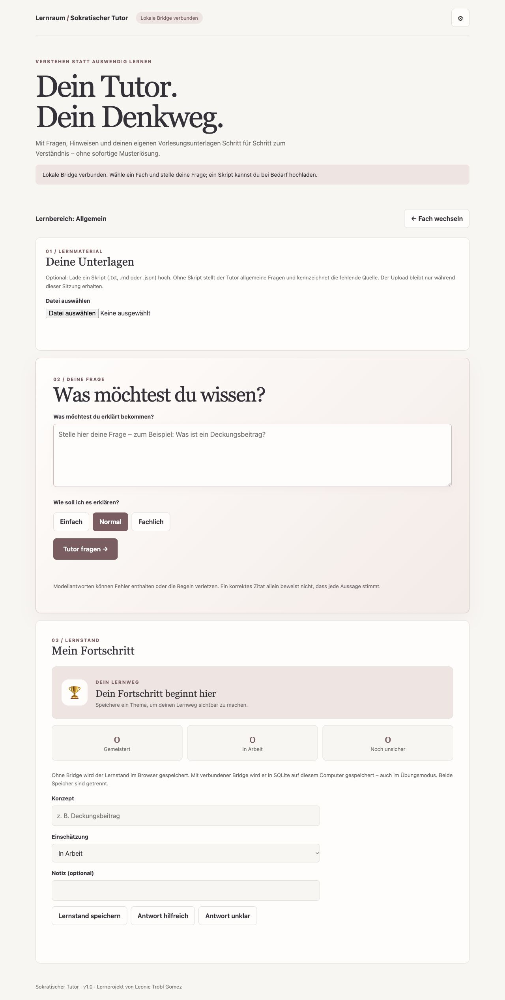
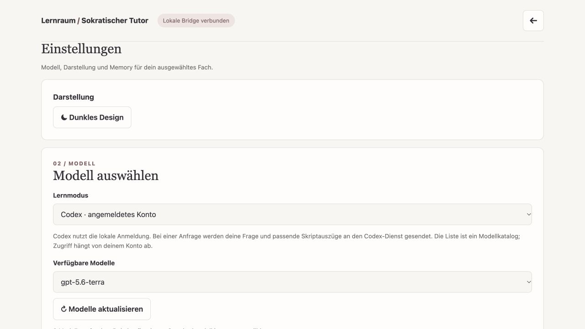

# Sokratischer Vorlesungs- und Klausur-Tutor

Ein eigenständiges Lernprojekt nach der [Trinity-Architekturreferenz](https://profengel.github.io/KI-Literacy/trinity-agenten.html): Rollenregeln, Projektkonventionen, Ablauf, Ausgabeschema, deterministische Werkzeuge und lokales SQLite-Gedächtnis sind getrennt. Der Tutor hilft mit Fragen und Hinweisen statt sofortiger Musterlösungen.

## Einblicke

Die Lernansicht verbindet optionale Unterlagen, Fragen in drei Erklärstufen und einen fachbezogenen Lernstand:



Modellauswahl, Dark Mode, Memory-Grafik und die Trinity-Dateien sind über die Einstellungen erreichbar:



## Start auf dem eigenen Computer

Python 3.9 oder neuer genügt; zusätzliche Pakete sind nicht erforderlich.

```sh
python3 server.py
```

Öffne anschließend **http://127.0.0.1:8001/**. Beenden mit `Strg+C`. Die Bridge hört ausschließlich auf diesem Computer; `--port 8002` ändert bei Bedarf den Port. Die App ist nicht für öffentliche Server oder gleichzeitige fremde Nutzer ausgelegt.

1. Ein Fach bzw. Projekt auswählen oder neu anlegen, dann eine Frage stellen. Optional `.txt`, `.md` oder `.json` (UTF-8) als Skript auswählen. Ohne Skript sind Hinweise allgemein und als nicht skriptbelegt gekennzeichnet. Skripte werden nicht dauerhaft gespeichert und beim Fachwechsel aus dem Formular entfernt.
2. Wähle eine Erklärstufe: einfach, normal (Standard) oder fachlich. Nach der Antwort kannst du die Stufe wechseln oder eine vertiefende Frage stellen. Nach „Verstanden“ kannst du eine Reflexionsaufgabe anfordern; diese Aktionen erzeugen jeweils eine neue Modellanfrage.
3. Codex wird bei verbundener Bridge vorausgewählt. Der Modellkatalog wird automatisch aus der lokalen Codex-Installation geladen; das konfigurierte Standardmodell wird vorausgewählt, sofern es im Katalog steht. Eine erfolgreiche Anfrage setzt eine gültige Anmeldung und Modellzugriff voraus.
4. Für Ollama (Port 11434) oder LM Studio (Port 1234) den lokalen Dienst starten und ein Modell laden. Beim Auswählen des Dienstes wird die Modellliste abgefragt.
5. Für OpenAI oder Gemini Modellnamen und Schlüssel für die Anfrage eingeben. Alternativ `OPENAI_API_KEY` bzw. `GEMINI_API_KEY` vor dem Start in der lokalen Umgebung setzen. Der eingegebene Schlüssel wird nach der Anfrage aus dem Formular entfernt und weder in Dateien noch in SQLite gespeichert. Konsolenausgaben protokollieren keine Anfragen.

**Cloud:** Bei Auswahl von Codex, OpenAI oder Gemini werden die Frage und ausgewählte Skriptauszüge an den jeweiligen Anbieter übertragen. Der Übungsmodus führt keine Modellanfrage aus. Für einen rein lokalen Betrieb nur ein tatsächlich lokal laufendes Modell verwenden.

## Codex und Antigravity

Im Cockpit ruft die lokale Bridge Codex direkt über die Codex-CLI auf. Alternativ kannst du den Projektordner im jeweiligen Harness öffnen und ihm `role.yaml`, `AGENTS.md`, `workflow.json`, `output.schema.json` und den relevanten Skriptauszug mit deiner Frage übergeben. Oder ein Prompt-Paket im Terminal ausgeben:

```sh
python3 cli.py --script /pfad/zum/skript.txt --question "Was ist der Deckungsbeitrag?"
```

Das Paket kann in Codex oder Antigravity eingefügt werden. Die CLI startet kein Harness automatisch und speichert das Skript nicht. Der Konsolentext kann sensible Skriptauszüge enthalten.

## Quellen, Grenzen und Speicher

Die lokale Bridge wählt anhand gemeinsamer Wörter Skriptabschnitte aus; sie ist keine semantische Suche. Ohne Treffer gibt sie eine Rückfrage statt einer erfundenen Quelle zurück. Das Modell muss ein JSON mit Verständnischeck, Hinweis, Rückfrage und Quellenstatus liefern. Ein angebliches Zitat wird deterministisch auf exakte Übereinstimmung mit den übermittelten Auszügen geprüft. Dies garantiert weder die sachliche Richtigkeit der gesamten Antwort noch die Befolgung der sokratischen Regel: LLMs können irren, Inhalte falsch deuten oder trotz Vorgaben eine Lösung verraten. Prüfe Antworten am Originalskript.

Beim Start über die Bridge werden explizit gespeicherte Lernstände und Bewertungen nach Projekt getrennt in `memory/memory.db` abgelegt – auch wenn der vorbereitete Übungsdialog ausgewählt ist. Die Memory-Grafik gruppiert deine gespeicherten Themen nach Status; sie behauptet keine Beziehungen zwischen Themen. Die Datei wird bei Bedarf automatisch erzeugt und ist durch `.gitignore` vom Repository ausgeschlossen. Skripte, Chatverlauf und Schlüssel werden dort nicht gespeichert. Im statischen Modus ohne Bridge liegt der Lernstand separat im Browser; eine automatische Synchronisierung findet nicht statt. Browserdaten und lokale Datenbank können verloren gehen: selbst sichern, wenn benötigt.

Das Zahnrad oben rechts öffnet die Einstellungen mit Modellauswahl, Dark Mode, Memory-Grafik und Trinity-Dateien. Der Entwicklungsverlauf erfasst Lernstandsänderungen ab Einführung dieser Funktion; ältere Änderungen lassen sich nicht rückwirkend rekonstruieren.

## GitHub Pages / Demonstration

`index.html` und `enhancements.js` können auch statisch auf GitHub Pages liegen: Dort funktionieren der vorbereitete Übungsdialog und Lernstand im Browser. Hochgeladene Unterlagen werden im Übungsmodus nicht analysiert. Modellanfragen, Datei-Inspektor, SQLite und Feedback benötigen die lokale Bridge; GitHub Pages führt kein Python aus. Keine Zugangsschlüssel im Repository hinterlegen.

## Tests

```sh
python3 -m unittest discover -s tests -v
```

Die Tests prüfen deterministische Skriptsuche, Zitatprüfung und lokale Fortschrittsdaten; sie ersetzen keine Prüfung einzelner Modellanbieter oder der Modellqualität.
